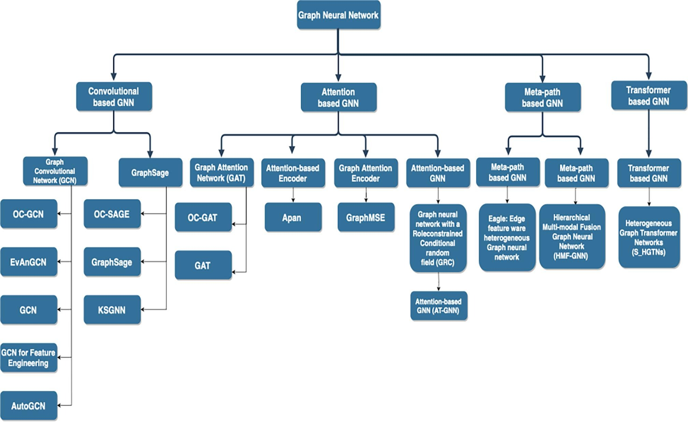

# Notes personnelles

## Review paper qui fait une bonne partie de notre travail

Le titre est "Financial fraud detection using graph neural networks: A systematic review" (10.1016/j.eswa.2023.122156). 

La conclusion indique que plusieurs qu'il y a un besoinde plus d'exploration pour "dynamic and heterogeneous graphs, particularly in cross-domain applications". "Moreover, we highlighted the limited availability of diverse graph datasets in some domains, such as taxation, and noted that certain areas of finance, such as real estate and mortgage, to name a few, have not been thoroughly explored."

"Although the majority of the papers we reviewed employed supervised methods for fraud detection, we advocate for a more extensive investigation into unsupervised and semi-supervised approaches. These methods are more practical and closer to real-world scenarios, as they hold the potential to reveal previously unseen patterns."

Résumé du review paper:

- 5 bases de données académiques et 33 articles choisis pour analyser l'etat de l'art actuel.
- Taxonomy: 4 catégories: Convolutional-based, Attention-based, Metapath-based, and Transformer-based models
- Principalement apprentissage supervisés
- Domaines d'application: cryptocurrency, credit cards, online payments, taxation, and insurance
- Types de graphes: homogeneous, heterogeneous, static, temporal, and dynamic graphs
- Lacunes de recherche:  Limited edge-level and graph-level anomaly detection; need for more unsupervised approaches

## Review paper de 2024

Titre: "Graph Neural Networks for Financial Fraud Detection: A Review".

### Abstract

- This review reveals that GNNs are exceptionally adept at capturing complex relational patterns and dynamics within financial networks, significantly outperforming traditional fraud detection methods.
- This review not only highlights the potential of GNNs to improve fraud detection mechanisms but also identifies current gaps and outlines future research directions
to enhance their deployment in financial systems.
- 100 studies reviewed

### Introduction

- Traditional rule-based systems and classic machine learning methods have been used for fraud detection, but they often struggle with complex fraud patterns on large amounts of financial data [5–11].
- Despite the potential of GNNs in fraud detection, there are practical challenges that need to be addressed. These include managing large-scale financial graph data and ensuring model adaptability to dynamic patterns [33–37].
- this study proposes the following detailed research questions (RQs):
    - RQ1: How can various GNN methodologies in financial fraud detection be understood through a unified framework?
    - RQ2: Why use GNNs for financial fraud detection? What roles do they play?
    - RQ3: How to design GNNs suitable for financial fraud detection?
    - RQ4: How are GNNs deployed in real-world financial fraud detection scenarios, and what are their impacts?
    - RQ5: What are the current challenges and futuredirections for GNNs in financial fraud detection?

## Datasets

- **Elliptic (Bitcoin Payment Flow):** A widely cited temporal graph mapping Bitcoin transactions[1]. It contains **203,769 address nodes** and **234,355 transaction edges** across 49 time steps, with labeled illicit transactions linked to scams, ransomware, and Ponzi schemes[2][3].
- **T-Finance:** A single-relation transaction network dataset containing **39,357 unique anonymized account nodes** and **21,222,543 transaction edges**[4][5]. Nodes are annotated by experts for fraud, money laundering, and online gambling (4.58% anomaly ratio)[6][7].
- **DGraph:** A massive real-world dynamic financial dataset modeling user interactions, loan-guarantor relations, and financial risks across millions of nodes[8].
- **FinFraudBench (CreditCard-Fraud &amp; BankTrans-Fraud):** Recent multi-entity, heterogeneous graph benchmarks constructed from real-world tabular financial records[11][12]. They include **6 node types** (*Transaction, Customer, Card, Merchant, Category, Location*) and **14 directed edge type**
- Elliptic2 (https://arxiv.org/abs/2404.19109). a large graph dataset containing 122K labeled subgraphs of Bitcoin clusters within a background graph consisting of 49M node clusters and 196M edge transactions. The dataset provides subgraphs known to be linked to illicit activity for learning the set of "shapes" that money laundering exhibits in cryptocurrency and accurately classifying new criminal activity